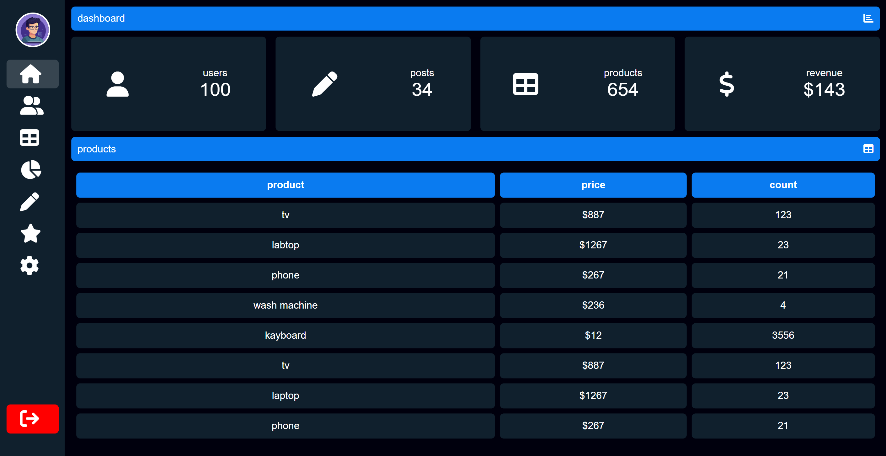

# Dashboard Web #01

A simple and responsive dashboard interface built with HTML and CSS.

## 📸 Screenshot



## 🚀 Features

- Dashboard overview with statistics.
- Data table to display information.
- Sidebar navigation.
- Clean and organized user interface.

## 🛠️ Technologies Used

- HTML5
- CSS3

## 📁 Project Structure

```text
dashboard_1/
├── hero.png
├── index.html
├── screenshot.png
├── style.css
└── README.md
```

## 💻 Getting Started

1. Download or clone this repository.
2. Open the project folder in VS Code.
3. Open `index.html` in your browser.
4. Explore the dashboard interface.

## 🎯 Purpose

This project was created to practice front-end web development skills using HTML and CSS.

## 👨‍💻 Author

Created by **Mustapha-aa**.

---

⭐ If you like this project, feel free to give it a star!